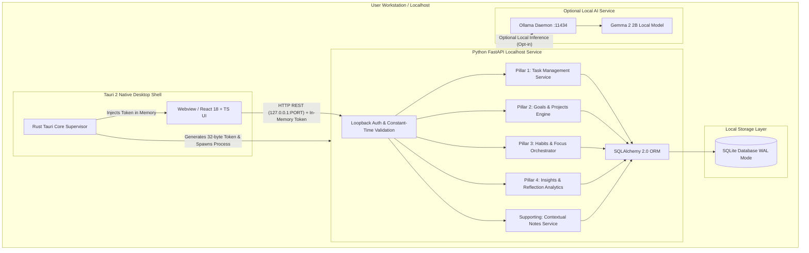

# System Architecture Specification

## 1. Architectural Overview & Four Core Pillars

The application employs a **hybrid desktop sidecar architecture**. A native desktop shell provides OS integration and process supervision, hosting an obsidian-dark webview interface. A dedicated Python FastAPI backend service executes on localhost, providing relational persistence across the **Four Core Pillars** and managing the optional local AI gateway.

---

## 2. Technology Stack & Runtime Compatibility Baseline

| Tier / Component | Technology | Version / Status | Compatibility & Evidence |
| :--- | :--- | :--- | :--- |
| **Desktop Shell** | **Tauri 2** (Rust) | v2.x | Native Rust shell; toolchain installation deferred to Milestone 3 |
| **Frontend Framework** | **React 18+**, **TypeScript**, **Vite** | Node 24.16, pnpm 11.1 | Verified present; instant HMR and strict typing |
| **Frontend Styling** | **Tailwind CSS**, **shadcn/ui** | v3/v4 | Gemini-inspired obsidian dark tokens, frosted glassmorphism |
| **Backend Engine** | **Python**, **FastAPI**, **Pydantic v2** | **Python 3.14.0** | **Empirically verified with `uv`**: pre-built wheels resolved for `fastapi==0.143.3`, `pydantic==2.14.1`, `pydantic-core==2.50.1`, `uvicorn==0.54.0` |
| **Persistence** | **SQLite 3**, **SQLAlchemy 2.0**, **Alembic** | System 3.44.4 | **Empirically verified with `uv`**: `sqlalchemy==2.1.5` and `alembic==1.20.0` resolve cleanly on Python 3.14 |
| **Optional Local AI** | **Ollama**, **Gemma 2 2B** | v0.40.6 | **Verified present**: `gemma2:2b` (1.6 GB) model already downloaded on local system |
| **Testing** | **Vitest** (Frontend), **Pytest** (Backend) | Pytest 9.1.1 | **Verified**: `pytest==9.1.1` and `httpx==0.28.1` resolve cleanly on Python 3.14 |

---

## 3. Comprehensive Security Architecture & Threat Model

### 3.1 Threat Model
- **Threat Vector 1: Malicious Local Processes**: Other unprivileged software or background processes on the user's computer attempting to probe localhost ports to access or alter private productivity data.
- **Threat Vector 2: Hostile Web Browser Contexts**: Malicious scripts in user's external web browser tabs attempting Cross-Site Request Forgery (CSRF), Cross-Origin Resource Sharing (CORS) abuse, or DNS rebinding against `127.0.0.1`.
- **Threat Vector 3: Credential & Token Leakage**: Exposure of authorization secrets through browser persistence storage (`localStorage`, `sessionStorage`, `IndexedDB`, cookies), browser history, or system log files.

### 3.2 Security Controls & Defenses

1. **Strict Loopback Binding**:
   - The Python backend binds **exclusively to `127.0.0.1`** (never `0.0.0.0` or local network adapters).
   - Host header validation ensures requests explicitly target `127.0.0.1` or `localhost`.
   - CORS origin whitelist is locked strictly to `tauri://localhost` (production) and `http://localhost:5173` (development).

2. **Ephemeral In-Memory Token Lifecycle**:
   - **Generation**: On startup, Tauri native core generates a cryptographically random 32-byte (256-bit) hex token (`secrets.token_hex(32)`).
   - **Injection**: Passed to the child Python sidecar via an isolated process environment variable (`APP_AUTH_TOKEN`).
   - **Frontend Delivery**: Injected into the frontend runtime memory via Tauri IPC secure state or root closure.
   - **Zero Persistent Storage Rule**: The session token **must NEVER be stored in `localStorage`, `sessionStorage`, cookies, or `IndexedDB`**. It lives exclusively in ephemeral JavaScript application memory and is discarded on window reload or application exit.

3. **Constant-Time Per-Request Authentication**:
   - Every incoming request (except `/api/v1/health`) must present `Authorization: Bearer <APP_AUTH_TOKEN>`.
   - The validation middleware uses **constant-time string comparison** (`secrets.compare_digest`) to prevent timing side-channel attacks.
   - Requests with missing, invalid, or malformed tokens are immediately terminated with `401 Unauthorized` before executing any business logic or touching SQLite.

4. **Log Redaction & Sanitization**:
   - Backend logging middleware intercepts all standard log streams.
   - Any occurrences of `Authorization` headers, session bearer tokens, and query secret parameters are sanitized to `[REDACTED]`.

5. **Security Test Suite**:
   - Automated Pytest suite executes dedicated security tests validating:
     - Unauthenticated requests are rejected with `401 Unauthorized`.
     - Invalid tokens fail constant-time comparison.
     - Sidecar rejects non-loopback binding.
     - Log files do not contain raw token strings.

---

## 4. Multi-Process Model & Lifecycle Management

### 4.1 Development vs Production Architecture
- **Milestones 1 & 2 (Browser Dev Mode)**:
  - Frontend runs on Vite dev server (`http://localhost:5173`).
  - Python FastAPI runs on `http://127.0.0.1:24125` using `uv` environment.
  - Ephemeral token is injected via Vite environment for local development.
  - Native Rust toolchain installation is **deferred to Milestone 3**.
- **Milestone 3+ (Tauri Desktop Shell)**:
  - Tauri launches native window and supervises child Python sidecar process.
  - Tauri performs healthcheck polling (`GET /api/v1/health`) before rendering UI.
  - On window close, Tauri dispatches graceful shutdown signal (`POST /api/v1/system/shutdown`), waits for clean database flush, and terminates the sidecar.

---

## 5. Storage & Persistence Architecture

- **SQLite 3 WAL Configuration**:
  - `PRAGMA journal_mode = WAL;` (Non-blocking reads and concurrent writes).
  - `PRAGMA synchronous = NORMAL;` (Maximum reliability and optimal write speed).
  - `PRAGMA foreign_keys = ON;` (Strict referential constraints).
  - `PRAGMA busy_timeout = 5000;` (5-second lock avoidance).
- **Alembic Migrations**:
  - All migrations versioned in `backend/alembic/versions/`.
  - Configured with `render_as_batch=True` to support SQLite table schema alteration safely.
  - Automated migration check (`alembic upgrade head`) executes on application boot.

---

## 6. Optional Local AI Architecture

- **Host**: Localhost Ollama daemon (`http://127.0.0.1:11434`).
- **Model**: `gemma2:2b` (pre-verified present on local workstation).
- **Protocol**:
  - Backend interfaces with Ollama; frontend never makes external or direct LLM calls.
  - Strictly read-only suggestions; user must explicitly click "Apply" to commit changes.
  - Every interaction logged to `ai_audit_logs`.
- **Offline Guarantee**: If Ollama is inactive, the core app functions 100% normally without warning popups or degraded task/goal/habit workflows.

---

## 7. Deferred Decisions
- **[OPEN-001] Native Rust Toolchain**: Deferred to Milestone 3 (Tauri integration).
- **[OPEN-002] Production Sidecar Packaging**: Deferred to Milestone 3 / 7 (PyInstaller vs. embedded Python runtime).
- **[OPEN-004] Design Reference Asset**: Reference image not yet in workspace; user to place in `docs/design-reference/`.
- **[OPEN-005] Cross-Device Synchronization**: Explicitly deferred to post-MVP Tier 3 roadmap.
