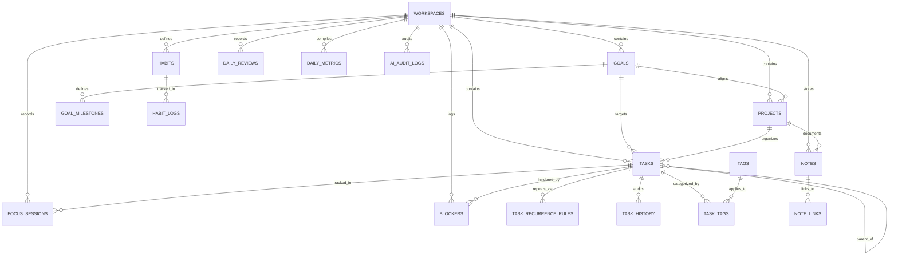

# Data Model & Schema Specification

## 1. Overview & Core Principles

The data persistence layer is implemented in **SQLite 3**, managed via **SQLAlchemy 2.0** declarative models, and evolved through **Alembic** migrations.

### Core Principles:
- **Offline Sovereignty & Non-Colliding IDs**: All entities use **UUIDv4** strings (`CHAR(36)`) for primary keys, enabling offline creation across processes without auto-increment collisions.
- **Strict Referential Integrity**: Cascading rules (`ON DELETE CASCADE` or `SET NULL`) enforced via `PRAGMA foreign_keys = ON;`.
- **Temporal Traceability**: All primary entities store ISO-8601 UTC timestamps for `created_at` and `updated_at`.
- **Pillar-Centric Architecture**: First-class entity structures for the four core pillars (Task Management, Goals & Projects, Habits & Focus, Insights & Reflection) with contextual supporting notes.

---

## 2. Entity-Relationship Diagram

---

## 3. Schema Definitions: Core Workspaces

### 3.1 `workspaces`
Isolated organizational environments (e.g. "Personal", "Engineering", "Consulting").

| Column | Type | Nullable | Default | Description |
| :--- | :--- | :--- | :--- | :--- |
| `id` | `VARCHAR(36)` | NO | PK | UUIDv4 identifier |
| `name` | `VARCHAR(100)` | NO | - | Workspace title |
| `slug` | `VARCHAR(100)` | NO | Unique | URL/path friendly identifier |
| `color` | `VARCHAR(20)` | YES | `'#6366F1'` | Accent color hex code |
| `icon` | `VARCHAR(50)` | YES | `'folder'` | Icon identifier |
| `is_default` | `BOOLEAN` | NO | `FALSE` | Primary default workspace |
| `created_at` | `DATETIME` | NO | `CURRENT_TIMESTAMP` | UTC timestamp |
| `updated_at` | `DATETIME` | NO | `CURRENT_TIMESTAMP` | UTC timestamp |

---

## 4. Pillar 1: Task Management Schema

### 4.1 `tasks`
Core executable units supporting nesting, project/goal linkage, duration tracking, and cognitive energy levels.

| Column | Type | Nullable | Default | Description |
| :--- | :--- | :--- | :--- | :--- |
| `id` | `VARCHAR(36)` | NO | PK | UUIDv4 identifier |
| `workspace_id` | `VARCHAR(36)` | NO | FK -> `workspaces.id` | Owning workspace |
| `project_id` | `VARCHAR(36)` | YES | FK -> `projects.id` | Associated project container |
| `goal_id` | `VARCHAR(36)` | YES | FK -> `goals.id` | Associated strategic goal |
| `milestone_id` | `VARCHAR(36)` | YES | FK -> `goal_milestones.id` | Specific goal checkpoint |
| `parent_id` | `VARCHAR(36)` | YES | FK -> `tasks.id` | Parent task (for subtask trees) |
| `recurrence_rule_id`| `VARCHAR(36)` | YES | FK -> `task_recurrence_rules.id` | Recurring schedule rule |
| `title` | `VARCHAR(255)` | NO | - | Short descriptive title |
| `description` | `TEXT` | YES | `NULL` | Markdown description or checklist |
| `status` | `VARCHAR(30)` | NO | `'todo'` | `draft`, `todo`, `in_progress`, `blocked`, `completed`, `archived` |
| `priority` | `VARCHAR(20)` | NO | `'medium'` | `low`, `medium`, `high`, `urgent` |
| `energy_level` | `INTEGER` | YES | `3` | Required cognitive energy (1=Low to 5=Deep Focus) |
| `estimated_minutes` | `INTEGER` | YES | `NULL` | Planned duration in minutes |
| `actual_minutes` | `INTEGER` | NO | `0` | Logged duration from focus sessions |
| `due_date` | `DATETIME` | YES | `NULL` | Deadline timestamp (UTC) |
| `position` | `INTEGER` | NO | `0` | Visual ordering index |
| `completed_at` | `DATETIME` | YES | `NULL` | Completion timestamp (UTC) |
| `created_at` | `DATETIME` | NO | `CURRENT_TIMESTAMP` | Creation timestamp (UTC) |
| `updated_at` | `DATETIME` | NO | `CURRENT_TIMESTAMP` | Modification timestamp (UTC) |

**Indexes**:
- `idx_tasks_workspace_status`: `(workspace_id, status)`
- `idx_tasks_project_id`: `(project_id)`
- `idx_tasks_goal_id`: `(goal_id)`
- `idx_tasks_due_date`: `(due_date)`
- `idx_tasks_parent_id`: `(parent_id)`

### 4.2 `task_recurrence_rules`
Defines automated repetition parameters for tasks.

| Column | Type | Nullable | Default | Description |
| :--- | :--- | :--- | :--- | :--- |
| `id` | `VARCHAR(36)` | NO | PK | UUIDv4 identifier |
| `workspace_id` | `VARCHAR(36)` | NO | FK -> `workspaces.id` | Owning workspace |
| `frequency` | `VARCHAR(20)` | NO | `'daily'` | `daily`, `weekdays`, `weekly`, `monthly`, `custom` |
| `interval_days` | `INTEGER` | NO | `1` | Interval step (e.g. every 2 weeks) |
| `by_weekdays_json`| `VARCHAR(50)` | YES | `NULL` | Specific days (e.g. `[1,3,5]` for Mon/Wed/Fri) |
| `start_date` | `DATE` | NO | - | Inception date |
| `end_date` | `DATE` | YES | `NULL` | Optional termination date |
| `next_due_date` | `DATE` | NO | - | Scheduled next occurrence |
| `created_at` | `DATETIME` | NO | `CURRENT_TIMESTAMP` | Creation timestamp |

### 4.3 `task_history`
Chronological state and modification ledger for task auditability.

| Column | Type | Nullable | Default | Description |
| :--- | :--- | :--- | :--- | :--- |
| `id` | `VARCHAR(36)` | NO | PK | UUIDv4 identifier |
| `task_id` | `VARCHAR(36)` | NO | FK -> `tasks.id` (CASCADE) | Audited task |
| `changed_field` | `VARCHAR(50)` | NO | - | Field modified (e.g. `status`, `priority`, `due_date`) |
| `old_value` | `TEXT` | YES | `NULL` | Value prior to mutation |
| `new_value` | `TEXT` | YES | `NULL` | Value after mutation |
| `timestamp` | `DATETIME` | NO | `CURRENT_TIMESTAMP` | Time of mutation (UTC) |

---

## 5. Pillar 2: Goals and Projects Schema (Core Pillar)

### 5.1 `goals`
Long-term and short-term strategic objectives.

| Column | Type | Nullable | Default | Description |
| :--- | :--- | :--- | :--- | :--- |
| `id` | `VARCHAR(36)` | NO | PK | UUIDv4 identifier |
| `workspace_id` | `VARCHAR(36)` | NO | FK -> `workspaces.id` | Owning workspace |
| `title` | `VARCHAR(255)` | NO | - | Goal title |
| `description` | `TEXT` | YES | `NULL` | Motivation, vision, or context |
| `goal_type` | `VARCHAR(20)` | NO | `'short_term'` | `long_term` (1-5 yrs), `short_term` (quarterly/monthly) |
| `target_date` | `DATE` | YES | `NULL` | Target horizon |
| `status` | `VARCHAR(20)` | NO | `'active'` | `active`, `completed`, `paused`, `abandoned` |
| `progress_percentage`| `INTEGER` | NO | `0` | Calculated roll-up progress (0-100%) |
| `color` | `VARCHAR(20)` | YES | `'#A855F7'` | Visual badge color |
| `icon` | `VARCHAR(50)` | YES | `'target'` | Icon identifier |
| `created_at` | `DATETIME` | NO | `CURRENT_TIMESTAMP` | Creation timestamp |
| `updated_at` | `DATETIME` | NO | `CURRENT_TIMESTAMP` | Modification timestamp |

### 5.2 `goal_milestones`
Measurable checkpoints within a goal.

| Column | Type | Nullable | Default | Description |
| :--- | :--- | :--- | :--- | :--- |
| `id` | `VARCHAR(36)` | NO | PK | UUIDv4 identifier |
| `goal_id` | `VARCHAR(36)` | NO | FK -> `goals.id` (CASCADE) | Parent goal |
| `title` | `VARCHAR(255)` | NO | - | Milestone title |
| `target_date` | `DATE` | YES | `NULL` | Target completion date |
| `is_completed` | `BOOLEAN` | NO | `FALSE` | Milestone status |
| `completed_at` | `DATETIME` | YES | `NULL` | Time marked complete |
| `position` | `INTEGER` | NO | `0` | Sequence order |
| `created_at` | `DATETIME` | NO | `CURRENT_TIMESTAMP` | Creation timestamp |

### 5.3 `projects`
Deliverable-oriented containers grouping tasks toward specific outcomes.

| Column | Type | Nullable | Default | Description |
| :--- | :--- | :--- | :--- | :--- |
| `id` | `VARCHAR(36)` | NO | PK | UUIDv4 identifier |
| `workspace_id` | `VARCHAR(36)` | NO | FK -> `workspaces.id` | Owning workspace |
| `goal_id` | `VARCHAR(36)` | YES | FK -> `goals.id` (SET NULL) | Strategic goal parent |
| `title` | `VARCHAR(255)` | NO | - | Project name |
| `description` | `TEXT` | YES | `NULL` | Scope and project description |
| `color` | `VARCHAR(20)` | YES | `'#6366F1'` | Project identity color |
| `status` | `VARCHAR(20)` | NO | `'active'` | `planning`, `active`, `on_hold`, `completed`, `archived` |
| `target_date` | `DATE` | YES | `NULL` | Target delivery date |
| `position` | `INTEGER` | NO | `0` | Display order |
| `created_at` | `DATETIME` | NO | `CURRENT_TIMESTAMP` | Creation timestamp |
| `updated_at` | `DATETIME` | NO | `CURRENT_TIMESTAMP` | Modification timestamp |

---

## 6. Pillar 3: Habits and Focus Schema

### 6.1 `habits`
Routine behavior definitions and streak tracking.

| Column | Type | Nullable | Default | Description |
| :--- | :--- | :--- | :--- | :--- |
| `id` | `VARCHAR(36)` | NO | PK | UUIDv4 identifier |
| `workspace_id` | `VARCHAR(36)` | NO | FK -> `workspaces.id` | Owning workspace |
| `title` | `VARCHAR(255)` | NO | - | Habit name |
| `description` | `TEXT` | YES | `NULL` | Habit instructions |
| `frequency` | `VARCHAR(20)` | NO | `'daily'` | `daily`, `weekdays`, `weekly_target` |
| `target_count` | `INTEGER` | NO | `1` | Daily occurrences or target days/week |
| `time_of_day` | `VARCHAR(20)` | YES | `'any'` | `morning`, `afternoon`, `evening`, `any` |
| `current_streak` | `INTEGER` | NO | `0` | Active consecutive streak |
| `best_streak` | `INTEGER` | NO | `0` | All-time highest streak record |
| `is_active` | `BOOLEAN` | NO | `TRUE` | Whether currently tracked |
| `created_at` | `DATETIME` | NO | `CURRENT_TIMESTAMP` | Creation timestamp |
| `updated_at` | `DATETIME` | NO | `CURRENT_TIMESTAMP` | Modification timestamp |

### 6.2 `habit_logs`
Daily execution log per habit.

| Column | Type | Nullable | Default | Description |
| :--- | :--- | :--- | :--- | :--- |
| `id` | `VARCHAR(36)` | NO | PK | UUIDv4 identifier |
| `habit_id` | `VARCHAR(36)` | NO | FK -> `habits.id` (CASCADE) | Logged habit |
| `log_date` | `DATE` | NO | - | Execution calendar date (`YYYY-MM-DD`) |
| `completed` | `BOOLEAN` | NO | `TRUE` | Checkoff status |
| `numeric_value`| `FLOAT` | YES | `1.0` | Value logged (e.g. pages read, cups of water) |
| `notes` | `TEXT` | YES | `NULL` | Optional log entry note |
| `created_at` | `DATETIME` | NO | `CURRENT_TIMESTAMP` | Timestamp logged |

**Unique Constraint**: `(habit_id, log_date)`

### 6.3 `focus_sessions`
Pomodoro and deep work execution intervals.

| Column | Type | Nullable | Default | Description |
| :--- | :--- | :--- | :--- | :--- |
| `id` | `VARCHAR(36)` | NO | PK | UUIDv4 identifier |
| `workspace_id` | `VARCHAR(36)` | NO | FK -> `workspaces.id` | Owning workspace |
| `task_id` | `VARCHAR(36)` | YES | FK -> `tasks.id` (SET NULL) | Associated task |
| `project_id` | `VARCHAR(36)` | YES | FK -> `projects.id` (SET NULL) | Associated project |
| `session_type` | `VARCHAR(20)` | NO | `'pomodoro'` | `pomodoro`, `stopwatch`, `deep_work` |
| `started_at` | `DATETIME` | NO | - | Session start timestamp |
| `ended_at` | `DATETIME` | YES | `NULL` | Session end timestamp |
| `duration_seconds` | `INTEGER` | NO | `0` | Completed focus duration |
| `interruption_count`| `INTEGER`| NO | `0` | Count of logged context switches |
| `energy_before`| `INTEGER` | YES | `NULL` | Pre-session energy level (1-5) |
| `energy_after` | `INTEGER` | YES | `NULL` | Post-session energy level (1-5) |
| `is_completed` | `BOOLEAN` | NO | `TRUE` | Whether planned block completed |
| `notes` | `TEXT` | YES | `NULL` | Debrief notes |
| `created_at` | `DATETIME` | NO | `CURRENT_TIMESTAMP` | Creation timestamp |

---

## 7. Pillar 4: Insights and Reflection Schema

### 7.1 `daily_reviews`
End-of-day guided reflections and subjective self-assessments.

| Column | Type | Nullable | Default | Description |
| :--- | :--- | :--- | :--- | :--- |
| `id` | `VARCHAR(36)` | NO | PK | UUIDv4 identifier |
| `workspace_id` | `VARCHAR(36)` | NO | FK -> `workspaces.id` | Owning workspace |
| `review_date` | `DATE` | NO | - | Review date (`YYYY-MM-DD`) |
| `wins` | `TEXT` | YES | `NULL` | What went well |
| `challenges` | `TEXT` | YES | `NULL` | What caused friction |
| `tomorrow_priorities`| `TEXT` | YES | `NULL` | Top commitments for next day |
| `mood_score` | `INTEGER` | YES | `NULL` | Daily mood rating (1-5) |
| `energy_score` | `INTEGER` | YES | `NULL` | Daily average energy rating (1-5) |
| `notes` | `TEXT` | YES | `NULL` | Freeform journal reflection |
| `created_at` | `DATETIME` | NO | `CURRENT_TIMESTAMP` | Creation timestamp |
| `updated_at` | `DATETIME` | NO | `CURRENT_TIMESTAMP` | Modification timestamp |

**Unique Constraint**: `(workspace_id, review_date)`

### 7.2 `blockers`
Obstacles impeding task or project progression.

| Column | Type | Nullable | Default | Description |
| :--- | :--- | :--- | :--- | :--- |
| `id` | `VARCHAR(36)` | NO | PK | UUIDv4 identifier |
| `workspace_id` | `VARCHAR(36)` | NO | FK -> `workspaces.id` | Owning workspace |
| `task_id` | `VARCHAR(36)` | YES | FK -> `tasks.id` (SET NULL) | Blocked task |
| `project_id` | `VARCHAR(36)` | YES | FK -> `projects.id` (SET NULL) | Blocked project |
| `title` | `VARCHAR(255)` | NO | - | Short blocker summary |
| `description` | `TEXT` | YES | `NULL` | Detailed context |
| `category` | `VARCHAR(30)` | NO | `'external'` | `external`, `technical`, `energy`, `scope` |
| `status` | `VARCHAR(20)` | NO | `'active'` | `active`, `resolved` |
| `created_at` | `DATETIME` | NO | `CURRENT_TIMESTAMP` | Logged timestamp |
| `resolved_at` | `DATETIME` | YES | `NULL` | Resolution timestamp |

### 7.3 `daily_metrics`
Pre-calculated historical rollups for high-velocity dashboard visualization.

| Column | Type | Nullable | Default | Description |
| :--- | :--- | :--- | :--- | :--- |
| `id` | `VARCHAR(36)` | NO | PK | UUIDv4 identifier |
| `workspace_id` | `VARCHAR(36)` | NO | FK -> `workspaces.id` | Owning workspace |
| `metric_date` | `DATE` | NO | - | Metric date |
| `focus_minutes_total`| `INTEGER`| NO | `0` | Total focus time in minutes |
| `planned_minutes_total`|`INTEGER`| NO | `0` | Planned workload in minutes |
| `tasks_completed_count`|`INTEGER`| NO | `0` | Completed task volume |
| `tasks_rolled_over_count`|`INTEGER`|NO | `0` | Tasks rescheduled/unfinished |
| `habits_completed_count`|`INTEGER`|NO | `0` | Completed habit count |
| `average_energy` | `FLOAT` | YES | `NULL` | Energy average |
| `created_at` | `DATETIME` | NO | `CURRENT_TIMESTAMP` | Creation timestamp |

---

## 8. Supporting Feature: Contextual Notes Schema

### 8.1 `notes`
Documentation supporting Goals, Projects, Tasks, and Reviews.

| Column | Type | Nullable | Default | Description |
| :--- | :--- | :--- | :--- | :--- |
| `id` | `VARCHAR(36)` | NO | PK | UUIDv4 identifier |
| `workspace_id` | `VARCHAR(36)` | NO | FK -> `workspaces.id` | Owning workspace |
| `project_id` | `VARCHAR(36)` | YES | FK -> `projects.id` (SET NULL) | Context project |
| `goal_id` | `VARCHAR(36)` | YES | FK -> `goals.id` (SET NULL) | Context goal |
| `title` | `VARCHAR(255)` | NO | - | Note title |
| `content_markdown` | `TEXT` | NO | `''` | Markdown content |
| `is_pinned` | `BOOLEAN` | NO | `FALSE` | Pinned to workspace |
| `is_archived` | `BOOLEAN` | NO | `FALSE` | Soft archive |
| `created_at` | `DATETIME` | NO | `CURRENT_TIMESTAMP` | Creation timestamp |
| `updated_at` | `DATETIME` | NO | `CURRENT_TIMESTAMP` | Modification timestamp |

### 8.2 `note_links`
Bidirectional wikilinks (`[[Target Note]]`) between notes.

| Column | Type | Nullable | Default | Description |
| :--- | :--- | :--- | :--- | :--- |
| `id` | `VARCHAR(36)` | NO | PK | UUIDv4 identifier |
| `source_note_id` | `VARCHAR(36)` | NO | FK -> `notes.id` (CASCADE) | Source note |
| `target_note_id` | `VARCHAR(36)` | NO | FK -> `notes.id` (CASCADE) | Destination note |
| `created_at` | `DATETIME` | NO | `CURRENT_TIMESTAMP` | Creation timestamp |

---

## 9. Local AI Audit Schema

### 9.1 `ai_audit_logs`
Mandatory local log recording every prompt and output generated via Ollama.

| Column | Type | Nullable | Default | Description |
| :--- | :--- | :--- | :--- | :--- |
| `id` | `VARCHAR(36)` | NO | PK | UUIDv4 identifier |
| `workspace_id` | `VARCHAR(36)` | NO | FK -> `workspaces.id` | Owning workspace |
| `action_type` | `VARCHAR(50)` | NO | - | `task_breakdown`, `goal_milestones`, `reflection` |
| `model_name` | `VARCHAR(50)` | NO | `'gemma2:2b'` | Model tag |
| `prompt_hash` | `VARCHAR(64)` | NO | - | SHA-256 hash of input |
| `prompt_text` | `TEXT` | NO | - | Full input prompt |
| `response_text`| `TEXT` | NO | - | Verbatim model completion |
| `user_decision`| `VARCHAR(20)` | NO | `'pending'` | `applied`, `rejected`, `dismissed` |
| `execution_time_ms`|`INTEGER`| NO | `0` | Latency in ms |
| `created_at` | `DATETIME` | NO | `CURRENT_TIMESTAMP` | Timestamp |
