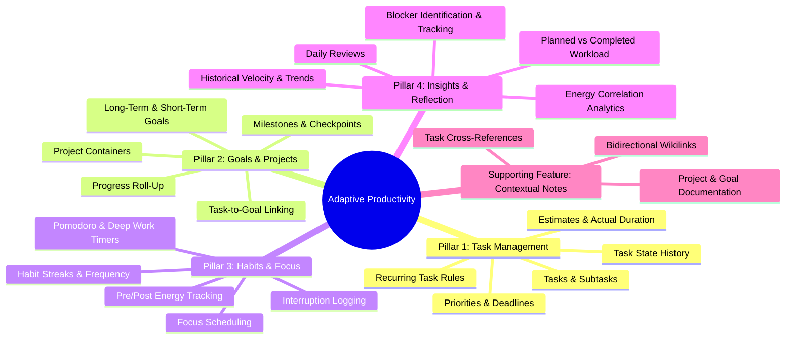

# Project Specification: Local-First Adaptive Productivity Desktop Application

## 1. Executive Summary
The **Adaptive Productivity Desktop Application** is an offline-first, privacy-sovereign desktop productivity suite built to unify execution, goal achievement, habit formation, and behavioral reflection into an adaptive personal system.

The application operates **100% locally on the user's workstation**. Data remains in an open SQLite database under the user's sole ownership. Zero remote accounts, cloud subscriptions, or external network connections are required for core operations.

An optional, strictly local AI upgrade layer interfaces with **Ollama running Gemma 2 2B**, providing intelligent task deconstruction, goal milestone breakdown, and reflection synthesis without sending any data over the internet.

---

## 2. The Four Core Pillars

---

### 2.1 Pillar 1: Task Management
A high-precision task execution engine supporting deep decomposition and longitudinal auditability:
- **Hierarchical Decomposition**: Arbitrarily nestable tasks and subtasks.
- **Priority Matrix**: Discrete prioritization (`Low`, `Medium`, `High`, `Urgent`).
- **Deadlines & Time Estimates**: Due dates, estimated durations (minutes), and actual duration aggregated from logged focus sessions.
- **Recurring Task Automation**: Flexible recurrence rules (Daily, Weekdays, Weekly, Bi-weekly, Monthly, or Custom intervals) generating subsequent task instances upon completion.
- **Task State History**: Complete audit log recording timestamped status changes (`draft`, `todo`, `in_progress`, `blocked`, `completed`, `archived`), title/description edits, and milestone completions.
- **Views**: Interactive Kanban board, inline-editable list view, and priority triage view.

---

### 2.2 Pillar 2: Goals and Projects (Core Pillar)
A structured framework connecting day-to-day actions to overarching personal and professional objectives:
- **Goal Hierarchy**:
  - **Long-Term Goals**: Visionary horizons (1–5 years).
  - **Short-Term Goals**: Tactical objectives (quarterly/monthly).
- **Milestones**: Measurable target checkpoints within each goal.
- **Projects**: Cohesive containers grouping tasks toward specific deliverables, linked directly to parent goals.
- **Task-to-Goal Mapping**: Every task can link to a project and an associated goal milestone.
- **Automatic Progress Roll-Up**: Dynamic progress calculation based on linked task completion and milestone achievement percentages.

---

### 2.3 Pillar 3: Habits and Focus
An integrated behavioural engine designed to build compounding routines and preserve cognitive flow:
- **Habit Tracking**:
  - Flexible cadence definitions (Daily, Weekdays, X times per week, Interval-based).
  - Target values (boolean checkoff or numeric count/duration).
  - Streak tracking: Current streak, best historical streak, and consistency scoring.
- **Focus Sessions**:
  - Pomodoro intervals (default 25m work / 5m break, fully customizable).
  - Unbounded Stopwatch / Deep Work session logger.
  - Mandatory association with an active task or project.
- **Cognitive Energy & Fatigue Tracking**:
  - Quick pre-session energy rating (1 to 5) to gauge baseline mental acuity.
  - Post-session energy rating (1 to 5) to measure cognitive drain.
- **Interruption Logging**: Rapid one-click counter to record context switches and friction during sessions.
- **Focus Scheduling & Timeboxing**: Allocating dedicated focus blocks for planned tasks and habits.

---

### 2.4 Pillar 4: Insights and Reflection
An adaptive feedback engine translating operational telemetry into personal growth and systemic tuning:
- **Daily Reviews**: Structured end-of-day guided reflection (wins, friction points, tomorrow's primary commitments).
- **Planned vs. Completed Workload**: Quantitative comparison of estimated effort versus actual execution, highlighting rollover tendencies and overcommitment.
- **Blocker Tracking**: Categorization and logging of recurring obstacles (`External`, `Technical`, `Energy/Fatigue`, `Unclear Scope`) with duration-to-resolution tracking.
- **Historical Analytics & Trends**: Longitudinal metrics covering velocity, habit completion consistency, deep work volume, and peak focus hours.
- **Energy Correlation Analysis**: Visual correlation between self-reported energy levels and task output to optimize daily scheduling.

---

### 2.5 Supporting Feature: Contextual Notes & Knowledge Capture
Notes serve as a **supporting capability** embedded across the core pillars:
- Direct attachment to Projects, Goals, Tasks, and Daily Reviews.
- Bidirectional wikilinks (`[[Note or Goal Title]]`) and automatic backlinks.
- Embedded actionable task checkboxes inside notes that link back to the Task Engine.

---

## 3. Workspace Tiers

| Tier | Deployment | Data Storage | AI Capabilities | Network Requirement |
| :--- | :--- | :--- | :--- | :--- |
| **Tier 1: Local Sovereign (Core)** | Local Desktop App | Local SQLite (WAL mode) | None | **Zero (100% Offline)** |
| **Tier 2: AI-Augmented Local** | Local Desktop App + Ollama | Local SQLite | Local Gemma 2 2B via Ollama | **Zero (Localhost Only)** |
| **Tier 3: Multi-Device Sync (Future)** | P2P / Encrypted Relay | Encrypted Local + Relay | Local Gemma 2 2B + Sync Engine | Local Network / Optional Relay |

> **Governance Note on Tier 3**: Multi-device sync is classified as **`DEFERRED (Post-MVP)`** and is strictly out of scope for the current roadmap.

---

## 4. Offline & Local-First Guarantees

1. **Zero External Boot Dependency**: The application boots, renders, and operates completely offline.
2. **Sub-50ms Mutation Latency**: Database transactions commit in < 50ms using SQLite WAL mode.
3. **Data Portability**: Full JSON export of all pillars (tasks, goals, habits, reviews, notes) and direct SQLite database backup.
4. **Resilient Local IPC**: Secure loopback communication over `127.0.0.1` between Tauri shell and Python sidecar.

---

## 5. Security & Threat Model Summary

- **Localhost Loopback Only**: Backend binds strictly to `127.0.0.1`.
- **In-Memory Ephemeral Session Token**:
  - 32-byte cryptographically secure token generated by Tauri on startup.
  - Injected directly into the sidecar process and frontend memory.
  - **Never stored in persistent browser storage** (`localStorage`, `sessionStorage`, cookies, `IndexedDB`).
  - Validated per-request using constant-time string comparison (`secrets.compare_digest`).
- **Log Sanitization**: All authorization tokens, query secrets, and sensitive content are redacted from logs.

---

## 6. Scope Boundaries & Milestones

### In-Scope (Milestones 0 – 7)
- Tauri 2 desktop shell, React 18+ Vite frontend, Python FastAPI sidecar, SQLite database.
- Complete implementation of the **Four Core Pillars** (Tasks, Goals & Projects, Habits & Focus, Insights & Reflection) + Supporting Notes.
- Optional local Ollama (Gemma 2 2B) integration under human-in-the-loop approval.
- Automated testing via Pytest and Vitest.

### Out-of-Scope (Deferred to Post-MVP)
- Cloud-hosted accounts, OAuth servers, or remote databases.
- Remote proprietary AI APIs (OpenAI, Anthropic, Google Cloud).
- Real-time collaborative multi-user editing.
- Multi-device cross-network sync engine.
