# MAX — Boost Your Self-Productivity

[](LICENSE)
[](ARCHITECTURE.md)
[-8A2BE2.svg)](AI_POLICY.md)
[](ARCHITECTURE.md)
[](TESTING.md)

**MAX** is a sovereign, local-first adaptive productivity desktop application built for deep work, goal achievement, habit compounding, and behavioral reflection.

Built with **Tauri 2 (Rust)**, **React 19**, **TypeScript**, **FastAPI (Python 3.14)**, **SQLite WAL**, and powered by an optional **100% offline local AI Coach (Ollama + Gemma 2 2B)**.

---

## 1. What MAX Is & The Problem It Solves

Modern knowledge workers and independent builders juggle disconnected tools: one for tasks, another for habit streaks, a timer for Pomodoro sessions, a spreadsheet for high-level goals, and cloud-hosted AI subscriptions that extract telemetry and expose sensitive personal priorities.

**MAX** unifies personal execution into a single, cohesive, high-density environment governed by three non-negotiable principles:
1. **Absolute Sovereignty & Privacy**: All personal data stays on your local machine in an ACID-compliant SQLite database. Zero external network calls, zero tracking telemetry, and zero mandatory cloud accounts.
2. **Unified Four Pillars Architecture**: Connects granular daily tasks directly to quarterly goals, sustained habits, and reflective behavioral insights.
3. **Local-First AI with Human Agency**: Offers whole-application productivity diagnosis and guidance powered entirely on-device by **Gemma 2 2B via Ollama**, operating on a strict **Review & Apply** paradigm where the AI can suggest, but *never unilaterally mutate* your data.

---

## 2. The Four Core Pillars & Supporting Notes

MAX structures execution across four interconnected pillars:

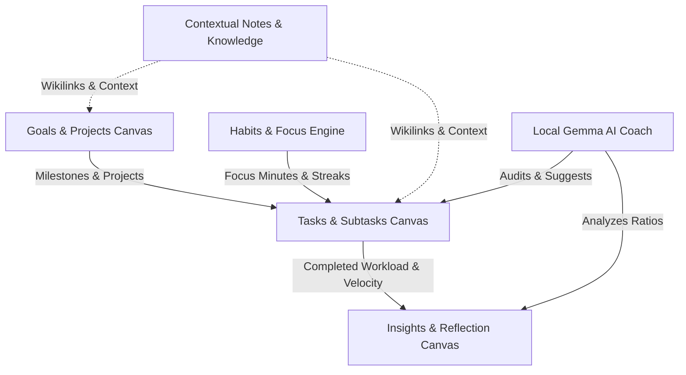

### Pillar 1: Task Management
- **Interactive Dual Views**: Switch seamlessly between a 3-column **Kanban Board** (To Do, In Progress, Done) with HTML5 drag-and-drop and a dense, sortable **List View**.
- **Parent/Subtask Hierarchy**: Expandable subtask accordions with automatic completion rollover.
- **Cognitive Energy Tagging**: Plan tasks according to focus levels (⚡ 1 Low Focus to 5 Deep Work).
- **Recurrence Engine**: Flexible schedules (Daily, Weekdays, Weekly, Monthly, or Custom intervals).
- **Itemized Audit History**: Detailed timeline tracking every property mutation (title, priority, estimate, status) with timestamps.
- **Rich Markdown Details**: Integrated Markdown editor with live Write / Preview tabs and toolbar.

### Pillar 2: Goals & Projects
- **Outcome Hierarchies**: Long-term and short-term goals connected to strategic projects.
- **Milestone Progress Rollup**: Dynamic percentage progress automatically computed from underlying milestone completions.
- **Horizon Filtering**: Rapidly filter active goals by time horizon (*All*, *Short-Term*, *Long-Term*, *Completed*).

### Pillar 3: Habits & Focus
- **Habit Compounding**: Daily check-ins, frequency targets (Daily, Weekly), and dynamic streak calculation.
- **Focus Engine HUD**: Circular Pomodoro progress ring and Stopwatch timer with one-click interval presets (25m Focus, 50m Deep Work, 15m Break).
- **Task Duration Rollover**: Attach active tasks directly to focus sessions; completed focus minutes automatically increment task duration.

### Pillar 4: Insights & Reflection
- **Deterministic Workload Velocity**: 7-day velocity bar charts tracking planned versus actual execution.
- **Estimation Accuracy**: Duration ratio metrics identifying whether you consistently over- or underestimate your work.
- **Blocker Resolution**: Identify cognitive bottlenecks and track active blockers to resolution.
- **Daily Review Journal**: End-of-day guided reflections recording what went well and what distracted you.

### Supporting Feature: Contextual Notes
- **Frictionless Knowledge Capture**: Local Markdown notes index with search filtering, pinned notes, and word/character counters.
- **Cross-Pillar Referencing**: Interlink notes, tasks, and goals with bidirectional context.

---

## 3. Local Gemma AI Coaching & Onboarding

MAX includes an optional, privacy-respecting intelligence layer powered by Google's open-weight **Gemma 2 2B** running on your local hardware via **Ollama**.

### Evidence-Backed Productivity Diagnosis
- Audits your SQLite database deterministically before generating suggestions.
- Flags concrete planning mistakes: overdue deadlines, excessive active tasks without focus, under-estimated complex tasks, and blocked workflows.
- Backs every recommendation with verifiable SQLite data metrics (active task count, completed ratio, duration ratio).

### Human-in-the-Loop "Review & Apply"
- In accordance with [`AI_POLICY.md`](AI_POLICY.md), the AI has **zero write permissions** to your database.
- Recommendations generate structured **Proposals** with before/after diffs.
- You can adjust proposed values inline (e.g. modify a proposed estimate or priority) and explicitly click **"Approve & Apply"** or **"Dismiss"**.
- Every approved mutation is logged to an immutable local `ai_audit_logs` table.

### Premium, Truthful Local Onboarding Flow
- **Automatic Multi-State Detection**: Truthfully detects whether Ollama is installed, whether the daemon is running on port 11434, and whether the `gemma2:2b` weights are downloaded.
- **Non-Blocking**: A prominent "Continue without AI" path allows full use of MAX's core four pillars without Ollama installed.
- **Guided Recovery**: Provides official download links, safe daemon launcher via allowlisted supervisor (`ollama serve`), verified model downloads, and bounded test inference (~400ms latency verification).

---

## 4. Technology Stack & System Architecture

MAX uses a dual-runtime desktop architecture:

```
+-----------------------------------------------------------+
|               Tauri 2 Native Desktop Shell                |
|  - Window Controls, Lifecycle Supervisor, Zero-Orphan Kill |
+-----------------------------+-----------------------------+
                              | In-Memory Ephemeral Token
+-----------------------------v-----------------------------+
|               Frontend (React 19 + TypeScript)            |
|  - Vite, Tailwind CSS v4, Lucide Icons, shadcn/ui          |
|  - Gemini-Dark obsidian aesthetic (#0B0F17, frosted glass) |
+-----------------------------+-----------------------------+
                              | Authenticated REST (127.0.0.1)
+-----------------------------v-----------------------------+
|               FastAPI Sidecar (Python 3.14)               |
|  - Constant-time token verification (secrets.compare_digest)|
|  - Sensitive header redaction middleware                  |
|  - SQLAlchemy 2.0 Declarative Models + Alembic Migrations |
+-----------------------------+-----------------------------+
                              |
               +--------------+--------------+
               |                             |
+--------------v--------------+ +------------v--------------+
|       Local SQLite WAL      | |    Ollama (127.0.0.1)     |
|  - data/app.db              | |  - Gemma 2 2B (Optional)  |
|  - 18 relational tables     | |  - Zero cloud leakage     |
+-----------------------------+ +---------------------------+
```

| Component | Technology | Description |
| :--- | :--- | :--- |
| **Desktop Shell** | **Tauri 2** (Rust) | Native Windows shell, window management, child process sidecar supervision |
| **Frontend** | **React 19**, **TypeScript**, **Vite** | Single-page application with strict type safety and sub-second HMR |
| **Styling** | **Tailwind CSS v4**, **shadcn/ui** | Custom Gemini-dark tokens, glassmorphism, tailored brand marks and artwork |
| **Backend** | **Python 3.14**, **FastAPI**, **uv** | Asynchronous local REST API bound strictly to loopback `127.0.0.1:24125` |
| **Persistence** | **SQLite 3**, **SQLAlchemy 2.0**, **Alembic** | ACID-compliant relational storage in WAL mode (`data/app.db`) |
| **Local AI** | **Ollama**, **Gemma 2 2B** | On-device open-weight LLM inference with zero network dependency |
| **Security** | **In-Memory Ephemeral Token** | 32-byte cryptographic token held only in memory (zero persistent browser storage) |

---

## 5. Installation & Startup Instructions (Windows)

### Prerequisites
- **Node.js** v20+ and **pnpm** v9+
- **Python** 3.12+ (Python 3.14 fully supported with pre-built wheels via `uv`)
- **Git**

### Step 1: Clone Repository
```powershell
git clone https://github.com/YUVA56-gomu/MAX---Boost-Your-Self-Productiviy.git
cd MAX---Boost-Your-Self-Productiviy
```

### Step 2: Install Dependencies
```powershell
# Frontend dependencies
pnpm --dir frontend install

# Backend dependencies (using uv or standard venv)
uv venv backend/.venv --python 3.14
uv pip install -e "backend[dev]" --python backend/.venv/Scripts/python.exe
```

### Step 3: Run Database Migrations
```powershell
backend\.venv\Scripts\python.exe -m alembic upgrade head
```

### Step 4: Launch Application

#### Option A: One-Command Dual-Runtime (Recommended)
```powershell
powershell -ExecutionPolicy Bypass -File scripts\start-dev.ps1
```
This starts both the FastAPI sidecar on `127.0.0.1:24125` and the Vite dev server on `127.0.0.1:5173`, automatically opening your browser to `http://127.0.0.1:5173/`.

#### Option B: Standalone Processes
```powershell
# Terminal 1: Backend
backend\.venv\Scripts\python.exe -m uvicorn backend.app.main:app --host 127.0.0.1 --port 24125

# Terminal 2: Frontend
pnpm --dir frontend dev --host 127.0.0.1 --port 5173
```

---

## 6. Local AI Setup (Ollama + Gemma 2 2B)

MAX is 100% functional without AI. To enable local intelligence:

1. **Install Ollama**: Download from [ollama.com/download](https://ollama.com/download).
2. **Pull Gemma 2 2B**:
   ```powershell
   ollama pull gemma2:2b
   ```
3. **Verify Ollama is Running**:
   ```powershell
   ollama list
   ```
4. **Open MAX**: Click the **AI Coach** link in the sidebar or click **"Let's advance with AI"**. The built-in setup wizard will automatically detect the model, perform a latency benchmark, and transition you directly to the AI Coach.

---

## 7. Security & Privacy Boundaries

- **Zero Cloud Accounts**: MAX does not have a user registration or cloud sync backend.
- **Strict Loopback Binding**: All HTTP and WebSocket traffic binds exclusively to `127.0.0.1`.
- **CORS Protection**: Access is restricted strictly to local origins (`http://localhost:5173`, `tauri://localhost`).
- **In-Memory Security Token**: A 32-byte cryptographic token is generated at boot and verified with `secrets.compare_digest`. The token is held only in memory and is **never written to persistent storage** (`localStorage`, `sessionStorage`, cookies, or `IndexedDB`).
- **Log Redaction**: All sensitive credentials (`Authorization`, `Cookie`) are masked as `[REDACTED]` in request logs.

---

## 8. Development & Verification Commands

```powershell
# Run all automated tests (124 tests passing)
pnpm test

# Run frontend unit & integration tests (69 Vitest tests)
pnpm --dir frontend test --run

# Run backend unit, CRUD, & security tests (55 Pytest tests)
backend\.venv\Scripts\python.exe -m pytest backend/tests -v

# Run fast code linter (Oxlint)
pnpm --dir frontend lint

# Compile production bundle
pnpm --dir frontend build
```

---

## 9. Visual Gallery & Screenshots

Authentic screenshots captured during live verification:

| Screen | Description |
| :--- | :--- |
| 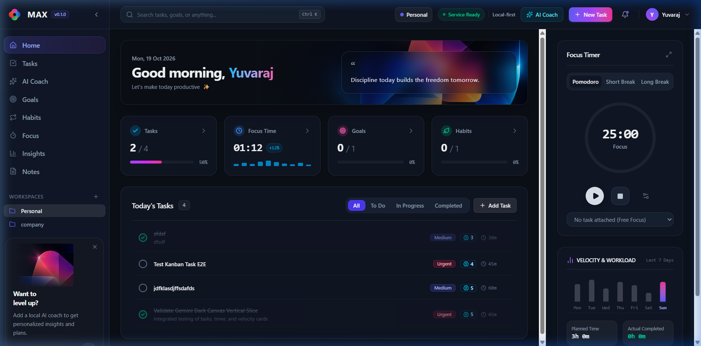 | **Home Dashboard**: Hero banner, Today's Tasks, stat strip, and quick focus timer. |
| 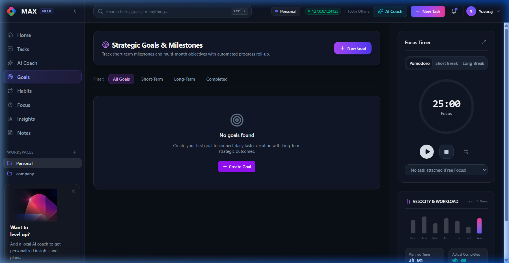 | **Tasks Canvas**: Kanban board with drag-and-drop, cognitive energy badges, and filters. |
| 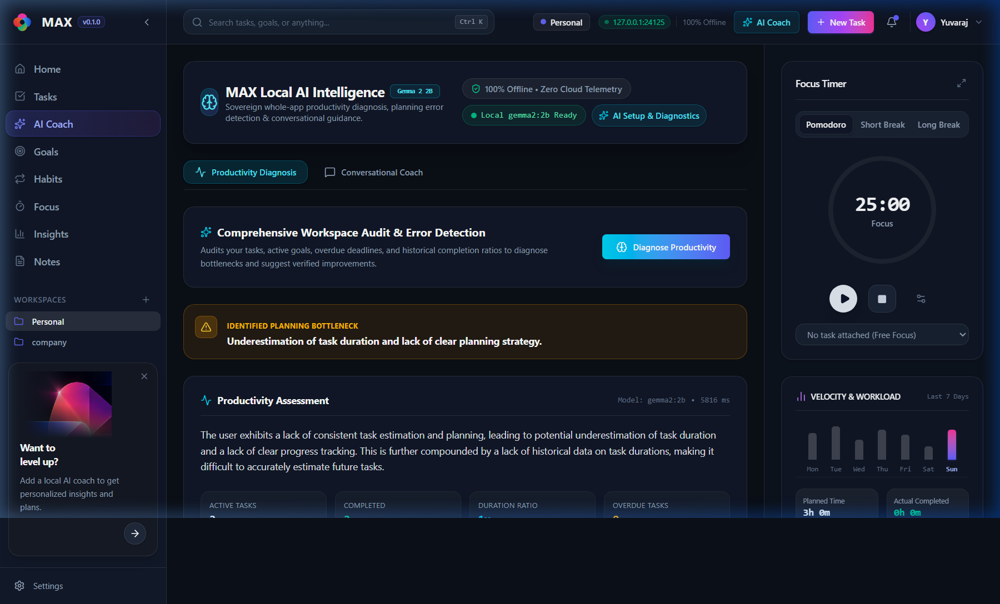 | **Whole-App Diagnosis**: Factual SQLite metrics auditing workload, duration ratios, and planning mistakes. |
| 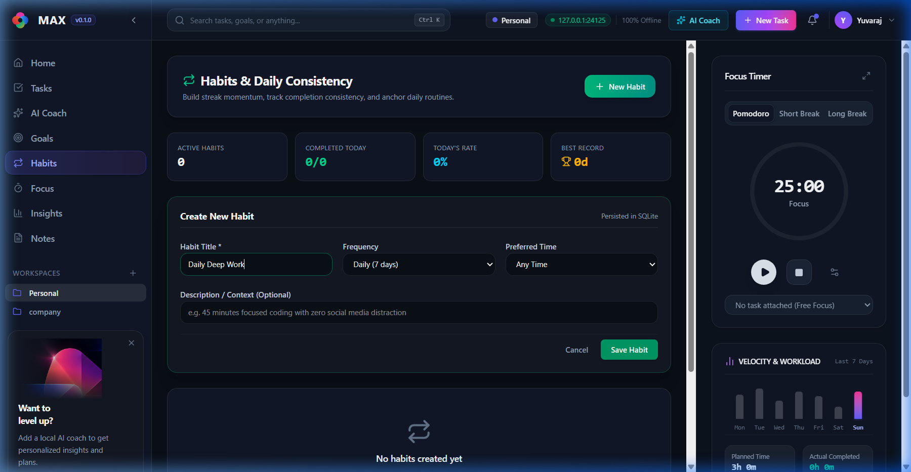 | **Review & Apply**: Human-in-the-loop proposal card with inline adjustments and explicit approval. |
| 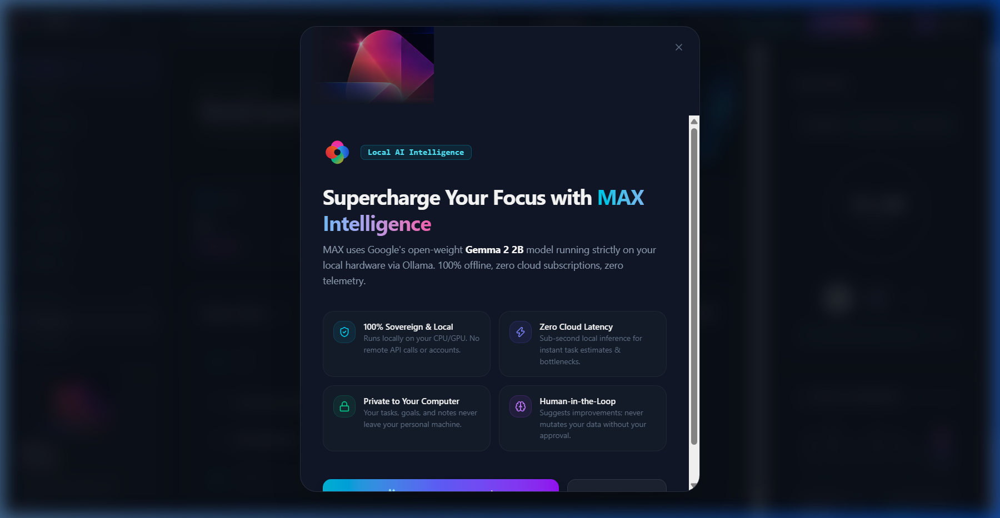 | **AI Onboarding Welcome**: Local-first privacy guarantee with optional setup or skip options. |
| 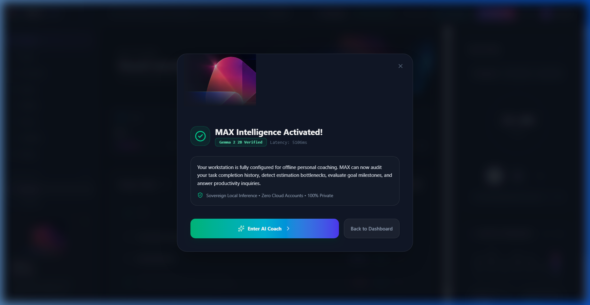 | **AI Activation**: Real system verification with bounded Gemma 2 2B latency benchmark. |
| 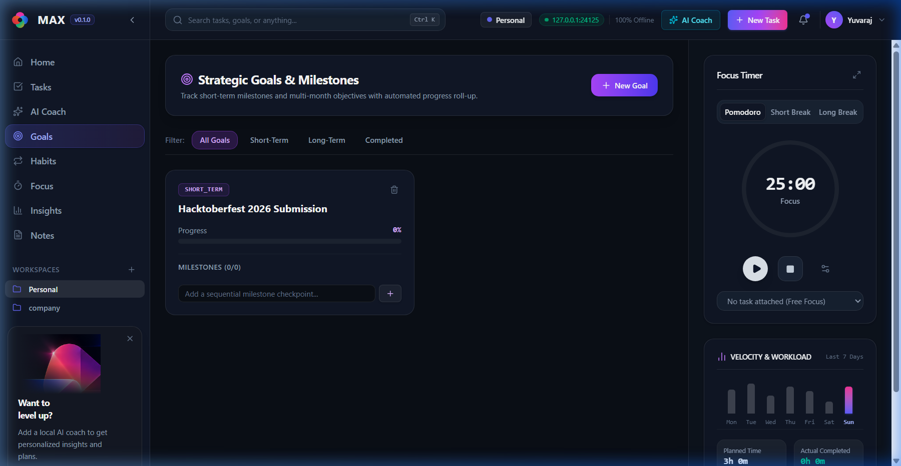 | **Goals Canvas**: Strategic goals, milestone rollups, and horizon filters. |
| 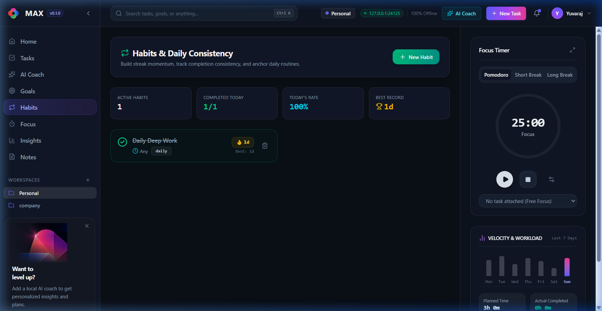 | **Habits Canvas**: Habit streak tracker with interactive daily check-in toggles. |
| 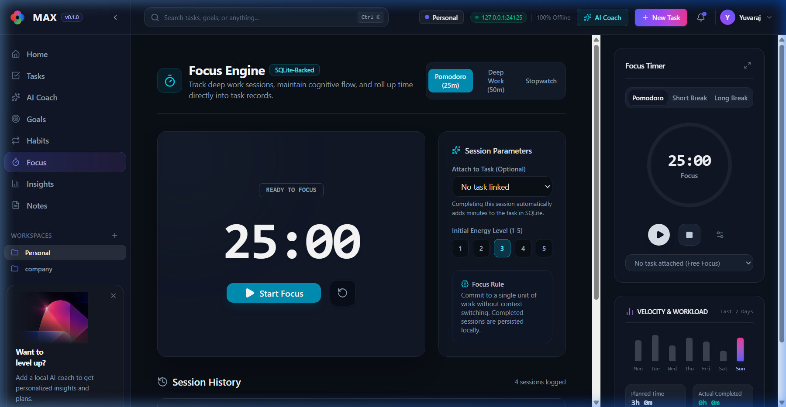 | **Focus Engine**: Pomodoro/Stopwatch HUD with interval presets and session log. |
| 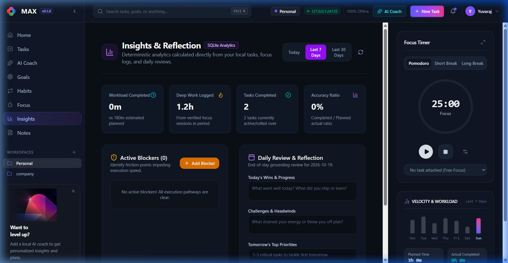 | **Insights & Reflection**: Workload velocity bar chart and daily review journal. |
| 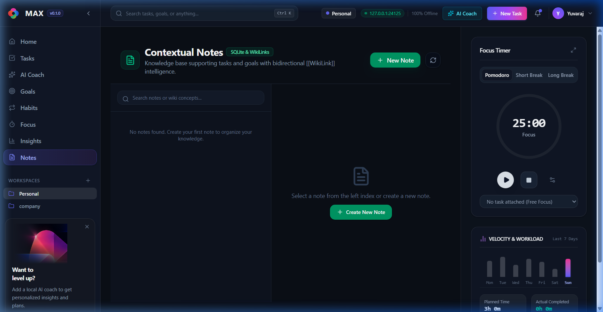 | **Notes Canvas**: Pinned Markdown notes with live Write / Preview tabs. |

---

## 10. License & Acknowledgments

- **License**: MIT License.
- **Visual Design**: Inspired by modern obsidian dark palettes, frosted glassmorphism, and Google Gemini design language.
- **Model**: Powered by Google's open-weight [Gemma 2 2B](https://ai.google.dev/gemma).
- Built with pride for **Hacktoberfest 2026 Week 2: Side Hustle**.
